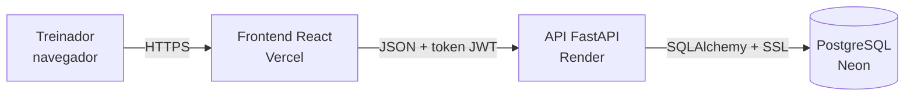
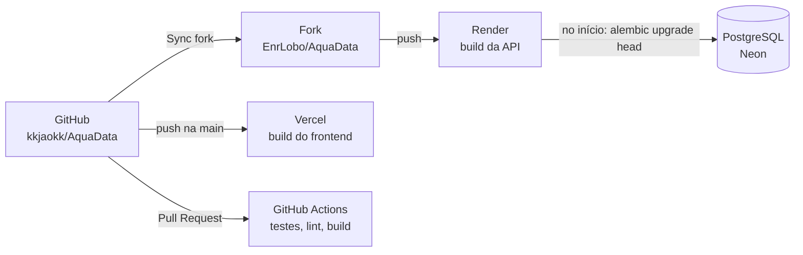

# Arquitetura

## Visão geral

O aquaData é uma aplicação web em três partes: um frontend em React (SPA), uma API REST em FastAPI e um banco PostgreSQL. O frontend nunca acessa o banco: toda leitura e gravação passa pela API, que valida os dados, aplica o isolamento por treinador e calcula as métricas e previsões.

| Parte | Hospedagem | Responsabilidade |
|---|---|---|
| Frontend | Vercel | Telas, formulários, gráficos, impressão do relatório |
| API | Render (web service gratuito) | Autenticação, validação, regras de negócio, métricas, predição, relatório e planilha |
| Banco | Neon (PostgreSQL gerenciado, plano gratuito) | Treinadores, atletas e registros de treino |

## Backend

Organizado em camadas, cada uma numa pasta de `backend/app/`:

| Camada | Pasta | Papel |
|---|---|---|
| Rotas | `api/` | Recebem a requisição, aplicam as dependências (banco, treinador logado, atleta do treinador) e montam a resposta |
| Esquemas | `schemas/` | Validam a entrada e definem a saída (Pydantic); as métricas de um treino são um campo calculado na saída |
| Serviços | `services/` | Regras de negócio em **funções puras** (sem banco nem HTTP), o que permite testá-las isoladamente |
| Modelos | `models/` | Tabelas e relacionamentos (SQLAlchemy) |
| Núcleo | `core/` | Configuração por variáveis de ambiente, conexão com o banco e segurança (hash de senha e JWT) |

Serviços:

| Arquivo | Conteúdo |
|---|---|
| `metrics.py` | Fórmulas das métricas de nado |
| `performance.py` | Resumo por métrica e linha de tendência (mínimos quadrados) |
| `prediction.py` | Modelo de Regressão Linear, avaliação treino/teste, projeção e selo de tendência |
| `report.py` | Relatório por atleta (filtro de período, tempos, gráfico) e planilha CSV |
| `simulation.py` | Estudos de simulação do modelo (usados pelos scripts) |
| `validation.py` | Comparação das métricas com o cálculo manual (validação com dados reais) |

Fluxo de uma requisição autenticada:

1. O frontend envia `Authorization: Bearer <token>`.
2. A dependência `CurrentCoach` (`api/deps.py`) decodifica o token e carrega o treinador; token inválido ou expirado → 401.
3. Nas rotas de um atleta, a dependência `OwnedAthlete` busca o atleta **filtrando pelo treinador logado**; atleta de outro treinador → 404 (não 403, para não revelar que existe).
4. A rota consulta o banco, chama os serviços e devolve o esquema de saída.

Decisões de projeto:
- **Métricas não são gravadas**: são calculadas a cada consulta a partir dos dados medidos. Se uma fórmula mudar, todo o histórico passa a usar a nova fórmula, sem dados inconsistentes.
- **Modelo de predição não é persistido**: é ajustado a cada consulta (poucas dezenas de registros, milissegundos), sempre com os dados mais recentes.
- **Atleta não é excluído, só inativado**, para preservar o histórico usado nas análises. Registros de treino podem ser excluídos (correção de erro de digitação).

## Autenticação

- Cadastro (`POST /auth/register`) com senha guardada como hash **Argon2** (pwdlib).
- Login (`POST /auth/login`, formulário OAuth2 com `username` = e-mail) devolve um **token JWT** assinado com HS256 pela `SECRET_KEY`, válido por 60 minutos. O identificador do treinador vai no campo `sub`.
- Login com e-mail inexistente e com senha errada têm a mesma resposta e custo de tempo semelhante (hash descartável), para não revelar quais e-mails estão cadastrados.
- O frontend guarda o token no `localStorage` e o envia em cada requisição; ao receber 401, faz logout e volta ao login.

## Frontend

| Pasta | Papel |
|---|---|
| `pages/` | Uma tela por rota |
| `components/` | Componentes das telas (formulários, gráficos, cartões); `components/ui/` tem os componentes básicos (botão, campo, seletor, alerta...) |
| `services/` | Chamadas à API; `api.js` centraliza o endereço, o token, o tratamento de erros e downloads |
| `context/` e `hooks/` | Autenticação (`AuthProvider`, `useAuth`) e tema claro/escuro (`ThemeProvider`, `useTheme`) |
| `utils/` | Datas, tempos (`m:ss,cc`) e a definição das métricas (rótulo, unidade, descrição, sentido de melhora) |

Rotas (todas, exceto login e cadastro, exigem login via `ProtectedRoute`):

| Rota | Tela |
|---|---|
| `/login`, `/cadastro` | Entrada e cadastro do treinador |
| `/` | Início (painel) |
| `/atletas`, `/atletas/novo`, `/atletas/:id/editar` | Atletas |
| `/treinos`, `/treinos/novo`, `/treinos/:athleteId/:sessionId`, `/treinos/:athleteId/:sessionId/editar` | Treinos |
| `/desempenho`, `/desempenho/:athleteId` | Desempenho (filtros guardados na URL) |
| `/relatorios`, `/relatorios/:athleteId` | Relatórios (período guardado na URL) |

Sistema de design: cores como variáveis CSS semânticas em `index.css` (`bg`, `surface`, `fg`, `muted`, `accent`, `brand`...), mapeadas no Tailwind, com tema claro (padrão) e escuro. A cor `brand` (`#1F78B8`) é uma variante mais escura do azul da marca (`#359FE2`) para atingir contraste adequado em botões e links.

## Implantação

- **Vercel** compila o frontend a partir da pasta `frontend` (`vercel.json` redireciona todas as rotas para o `index.html`). A variável `VITE_API_URL` é embutida no build: mudou, refazer o deploy.
- **Render** lê o **fork** (o integrante que configurou o serviço não é dono do repositório principal), a partir da pasta `backend`, e publica a API como web service gratuito em Python 3.13. O comando de início roda `alembic upgrade head` e depois `uvicorn app.main:app` (no plano gratuito não há pré-deploy separado, então as migrations rodam a cada início; o comando não faz nada quando o banco já está na última versão). Variáveis: `PYTHON_VERSION`, `DATABASE_URL`, `SECRET_KEY`, `CORS_ORIGINS`. No plano gratuito, o serviço desliga depois de 15 minutos sem requisições e leva cerca de um minuto para voltar.
- **Neon** hospeda o PostgreSQL (plano gratuito, sem prazo de validade, 1 GB). A conexão usa SSL (`sslmode=require` na `DATABASE_URL`) e a conexão direta, sem o pooler. A computação do banco também desliga quando fica sem uso e volta na primeira consulta.
- Até novembro de 2026, API e banco ficavam na Railway; com o fim do período de teste, foram migrados para Render e Neon (ver o histórico em `desenvolvimento.md`).
- **GitHub Actions** (`.github/workflows/tests.yml`) roda os testes do backend com um PostgreSQL temporário e o lint e o build do frontend em cada Pull Request.
- Os bancos local e de produção são independentes: as migrations replicam a estrutura, não os dados.