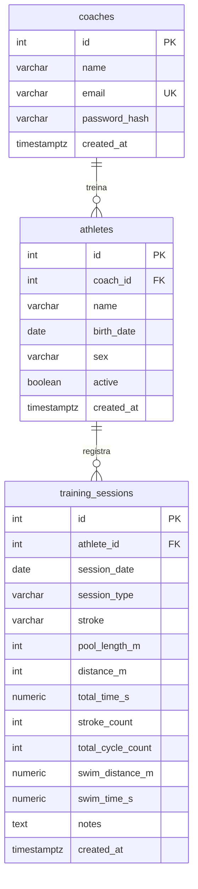

# Banco de dados

PostgreSQL 18 (a mesma versão no ambiente local, no GitHub Actions e em produção no Neon), acessado pelo SQLAlchemy 2 (`backend/app/models/`), com a estrutura versionada por migrations do Alembic (`backend/alembic/versions/`).

## Modelo

Três tabelas em cadeia: um treinador tem vários atletas, e cada atleta tem vários registros de treino ou competição.



### `coaches` (treinadores)

| Coluna | Tipo | Observação |
|---|---|---|
| `id` | inteiro | Chave primária |
| `name` | texto (120) | |
| `email` | texto (255) | Único, guardado em minúsculas |
| `password_hash` | texto (255) | Hash Argon2; a senha nunca é guardada |
| `created_at` | data e hora | Preenchido pelo banco |

### `athletes` (atletas)

| Coluna | Tipo | Observação |
|---|---|---|
| `id` | inteiro | Chave primária |
| `coach_id` | inteiro | Chave estrangeira para `coaches`, com índice |
| `name` | texto (120) | Espaços normalizados pela API |
| `birth_date` | data | |
| `sex` | texto (1) | `M` ou `F` |
| `active` | booleano | Atleta inativo mantém o histórico e não recebe registros novos |
| `created_at` | data e hora | |

### `training_sessions` (registros de treino e competição)

| Coluna | Tipo | Observação |
|---|---|---|
| `id` | inteiro | Chave primária |
| `athlete_id` | inteiro | Chave estrangeira para `athletes`, com índice |
| `session_date` | data | Com índice |
| `session_type` | texto (20) | `training` ou `competition` |
| `stroke` | texto (20) | `freestyle`, `backstroke`, `breaststroke`, `butterfly` ou `medley` |
| `pool_length_m` | inteiro | 25 ou 50 |
| `distance_m` | inteiro | Distância total |
| `total_time_s` | decimal (8,2) | Tempo total em segundos, com centésimos |
| `stroke_count` | inteiro | Ciclos de braçada no **trecho de nado puro** |
| `total_cycle_count` | inteiro, nulo permitido | Ciclos de braçada na **prova completa** (base do SWOLF); nulo nos registros anteriores ao campo, obrigatório na API |
| `swim_distance_m` | decimal (6,2) | Distância do trecho de nado puro |
| `swim_time_s` | decimal (8,2) | Tempo do trecho de nado puro |
| `notes` | texto | Observações |
| `created_at` | data e hora | |

As **métricas não são colunas**: são calculadas a cada consulta (`services/metrics.py`).

## Integridade

| Regra | Onde | Efeito |
|---|---|---|
| `athletes.coach_id` → `coaches.id` | `ON DELETE RESTRICT` | Treinador com atletas não pode ser apagado |
| `training_sessions.athlete_id` → `athletes.id` | `ON DELETE CASCADE` | Apagar um atleta apaga seus registros (a API não oferece exclusão de atleta) |
| `ck_pool_length` | `pool_length_m IN (25, 50)` | |
| `ck_distance_positive` | `distance_m > 0` | |
| `ck_total_time_positive` | `total_time_s > 0` | |
| `ck_stroke_count_nonneg` | `stroke_count >= 0` | A API exige pelo menos 1 |
| `ck_total_cycle_count_positive` | nulo ou `>= 1` | |

As validações mais detalhadas (distância múltipla da piscina, trecho menor que o total, velocidade máxima, data não futura) ficam na API (`schemas/session.py`); os CHECKs do banco são uma segunda barreira. Os testes de integração (`tests/integration/test_database.py`) confirmam essas regras direto no banco.

**Enums** são gravados como texto pelo **valor** (`freestyle`, não `FREESTYLE`), com `native_enum=False` e `values_callable=enum_values` (`models/base.py`).

## Migrations

| Revisão | Descrição |
|---|---|
| `afd3192fa021` | Cria as tabelas iniciais |
| `8474d8c39620` | Torna obrigatórios os campos do trecho de nado puro |
| `c41e7b2d9a05` | Adiciona `total_cycle_count` (ciclos da prova completa) |

Comandos, na pasta `backend` com o venv ativo:

```powershell
alembic upgrade head        # aplica todas as migrations
alembic downgrade -1        # desfaz a última
alembic current             # mostra a versão do banco
alembic revision --autogenerate -m "descricao"   # gera uma migration nova a partir dos modelos
```

Ao criar uma migration:
- revisar o arquivo gerado antes de aplicar (o autogenerate não detecta tudo, como mudanças em CHECKs);
- testar `upgrade head`, `downgrade -1` e `upgrade head` de novo, para garantir que é reversível;
- coluna nova obrigatória em tabela com dados: criar como nula ou com valor padrão, porque `NOT NULL` falha se já houver linhas.

Em produção (Neon), o comando de início da API no Render roda `alembic upgrade head` antes de subir o servidor. Os testes de integração recriam o banco de teste pelas migrations a cada execução (sobem, descem e sobem de novo).